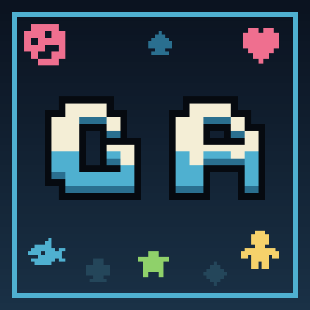

# Glyph Arcade

Thirteen little mobile games in one file, built from Mrmo's 1-bit art packs
(Oh No More Goblins, MRMOTEXT, Microbe-2, LambdaRogue, Precise-M) and styled
after the MRMO CRT, Halftone and DMG looks, plus a blueprint style.

Play it: open `index.html`, or visit the GitHub Pages site for this repo.
On iPhone, use Share → Add to Home Screen to get the app icon.

## Games

**On the Telly (CRT)**
- **Channel Surfer**: one hero across three TV channels with different walls.
- **Signal Lost**: station horror; things in the static only move when unseen.
- **Static Fishing**: tune a dial to reel creatures out of the snow.
- **Rerun Rush**: an endless runner where every channel change rewrites the rules.

**In the Newspaper (halftone)**
- **Microbe Petri**: eat smaller microbes, mutate, spell power words.
- **Petri Match**: match-3 with microbes.
- **Ransom Note**: snip falling magazine letters into words.
- **The Chess Column**: full chess against three levels of computer opponent.

**In Your Pocket (handheld)**
- **Lucky Hand**: poker hands plus a slot machine full of lucky charms.
- **Pocket Drop**: a falling-block puzzler.
- **Pocket Golf**: nine holes of mini golf.

**On the Drawing Board (blueprint)**
- **Coin Contraption**: place ramps and belts to steer a coin into the bank.
- **Patent Office**: approve or reject goblin inventions by spotting flaws.

Everything (art, font, word list) is embedded in `index.html`; there are no
other files to load.
